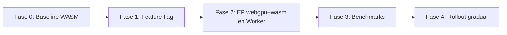

# ADR 001: WebGPU & Multi-Format Output (Native-First)

**Status:** Accepted (Research Phase closed — decisiones cerradas)
**Date:** 2026-10-11
**Deciders:** [Tu nombre]
**Branch:** `feat/webgpu-native-formats`
**Technical Story:** Investigación y análisis para (a) aceleración con WebGPU y (b) soporte de múltiples formatos de **salida**, priorizando los que ya tienen soporte nativo en navegadores.

---

## 0. Resumen de decisiones (TL;DR)

| Tema | Decisión propuesta | Riesgo | Impacto servidor | Impacto usuario |
|------|--------------------|--------|------------------|-----------------|
| **WebGPU** | Opción A: `onnxruntime-web/webgpu` + fallback WASM, detección automática — **✅ validado en spike** (ver [spike-webgpu.md](./spike-webgpu.md)) | Medio | ~0 (todo client-side) | 5-10x más rápido (solo Chromium) |
| **Formatos salida** | Scope nativo: **PNG, JPEG, WebP**. AVIF/JXL fuera de v1 (requieren WASM) | Bajo | ~0 (todo client-side) | Menos tamaño, más compatibilidad |

> **Hallazgo clave:** todo el pipeline (decode → inferencia → encode) corre en el navegador. Ni WebGPU ni los formatos afectan al cómputo del servidor; solo al **tamaño de bundle/assets** que se sirven.

---

## 1. Contexto Actual

### Stack Tecnológico
- **Framework:** Next.js 15 + React 19 + TypeScript
- **Inferencia:** `onnxruntime-web@1.20.1`, **WASM EP** (`numThreads = 1`, `proxy = false`)
- **Modelo:** `realesr-general-x4v3.onnx` → **4.7 MB**, servido desde `public/models/` (Fly.io)
- **Image I/O:** Canvas 2D (`createImageBitmap` / `canvas.toBlob`), salida actual fija **PNG**
- **Concurrencia:** Web Worker dedicado (`upscale.worker.ts`), tiling con padding
- **Arquitectura:** Clean Architecture (Domain / Application / Infrastructure), puertos `ImageCodec` y `ImageUpscaler`
- **Despliegue:** Fly.io (`output: "standalone"`), 1 CPU shared, 1 GB RAM, `min_machines_running = 0`

### Flujo Actual
```
Usuario sube imagen → createImageBitmap → Canvas 2D → RgbaImage
                                                       ↓
                                       Worker (ONNX Runtime WASM, tiling)
                                                       ↓
                                       RgbaImage 4x → canvas.toBlob('image/png')
                                                       ↓
                                       Descarga (nombre fijo .png)
```

### Naturaleza client-side (crítico para la proyección)
| Etapa | Dónde corre | Depende del servidor |
|-------|-------------|----------------------|
| Decode | Navegador (Canvas) | No |
| Inferencia | Navegador (Worker + ORT) | No (solo descarga el `.onnx`) |
| Encode | Navegador (Canvas) | No |
| SSR/HTML | Fly.io | Sí (estático) |
| Modelo `.onnx` (4.7 MB) | Fly.io `public/` | Sí (bandwidth) |
| Binarios WASM de ORT | jsDelivr CDN | No (los sirve el CDN) |

### Limitaciones Identificadas
| Área | Limitación Actual |
|------|-------------------|
| **Rendimiento** | WASM single-thread; sin uso de GPU |
| **Formatos salida** | Solo PNG hardcodeado (`result-display.tsx`), sin calidad ni formato elegible |
| **Calidad/eficiencia** | PNG de una imagen 4x es enorme (p. ej. 4MP → decenas de MB) |
| **UX** | Sin selector de formato, calidad ni previsualización de tamaño |

---

## 2. Proyección de Efecto (Servidor y Usuario)

Esta sección responde explícitamente al pedido de validar "viabilidad y proyección de efecto para el servidor y para el usuario".

### 2.1 Efecto en el servidor

| Dimensión | WebGPU | Formatos (nativos) | Formatos (WASM AVIF/JXL) |
|-----------|--------|--------------------|--------------------------|
| CPU/RAM de inferencia | **0** (client-side) | 0 | 0 |
| Peticiones a la API | 0 | 0 | 0 |
| Assets servidos | +0 (bundle webgpu ya en npm/CDN) | +0 | +~0.3-1 MB (lazy) |
| Bandwidth del modelo | Igual (4.7 MB) | Igual | Igual |
| Coste Fly.io | **Sin cambios** | Sin cambios | Sin cambios |

**Conclusión servidor:** ninguna de las dos iniciativas mueve la aguja en cómputo del servidor. Las únicas variables reales son:
1. **Bandwidth del modelo (4.7 MB)** por primera carga — independiente de WebGPU/formatos. Oportunidad futura: servir el `.onnx` desde CDN y/o cachearlo agresivamente (`Cache-Control: immutable`).
2. **Peso del bundle JS** si se añaden codecs WASM (AVIF/JXL), que debe ser **lazy-loaded** y fuera del camino crítico.

> ⚠️ Nota: `onnxruntime-web/webgpu` es un bundle distinto y más pesado que el WASM-only. Debe cargarse **solo dentro del Worker** y de forma diferida.

### 2.2 Efecto en el usuario

| Dimensión | WebGPU | Formatos (nativos) |
|-----------|--------|--------------------|
| **Velocidad** | 5-10x en Chromium; sin cambio en Safari/Firefox (fallback WASM) | Sin cambio de velocidad de inferencia; encode WebP ~similar a JPEG |
| **Tamaño descarga** | Igual | **-30% a -60%** vs PNG (WebP/JPEG en fotos) |
| **Compatibilidad** | Requiere Chrome/Edge 113+; resto WASM | PNG/JPEG universales; WebP encode **falla en Safari** (cae a PNG) |
| **Batería/térmica** | Puede subir en móvil (GPU) | Neutro |
| **Privacidad** | Igual (todo local) | Igual (todo local) |
| **Calidad** | Igual (mismo modelo) | Control de calidad lossy; lossless en PNG |

**Conclusión usuario:** WebGPU mejora drásticamente la latencia **solo donde ORT Web soporta WebGPU (Chromium)**. El multi-formato nativo da ganancias de tamaño inmediatas y sin coste de compatibilidad, **excepto** la trampa de WebP en Safari (ver §4.3).

---

## 3. Tema 1: Aceleración con WebGPU

### 3.1 Estado real (2026)

**Soporte del navegador (WebGPU API):**
| Navegador | Soporte | Desde |
|-----------|---------|-------|
| Chrome / Edge (Win, macOS, ChromeOS) | ✅ | 113 |
| Chrome / Edge (Android) | ✅ | 121 |
| Chrome / Edge (Linux Intel Gen12+) | ✅ | 144 |
| Safari (macOS/iOS/iPadOS 26) | ✅ | 26 |
| Firefox (Windows) | ✅ | 141 |
| Firefox (macOS Apple Silicon) | ✅ | 145 |

**Soporte del WebGPU EP en `onnxruntime-web` (esto es lo que importa):**
| Plataforma | ORT Web WebGPU EP |
|------------|-------------------|
| Chrome/Edge (Windows) | ✅ (v113+, fp16 v121+) |
| Chrome/Edge (Android) | ✅ (v121+) |
| Chrome/Edge (macOS) | ✅ |
| Chrome/Edge (iOS) | ❌ |
| **Safari (macOS / iOS)** | **❌** |
| **Firefox** | **❌** |
| WebNN | ✅ solo Chrome tras flag |

> 🔴 **Punto crítico:** aunque Safari 26 y Firefox 141+ ya soportan la **API WebGPU**, el **execution provider de ORT Web aún no** las soporta. Por eso el fallback a WASM **no es opcional, es obligatorio**.

### 3.2 Opciones de Migración

#### Opción A: `onnxruntime-web/webgpu` + fallback WASM  ⭐ RECOMENDADA
```typescript
// upscale.worker.ts — importar el bundle con WebGPU
import * as ort from 'onnxruntime-web/webgpu'

const session = await ort.InferenceSession.create(modelUrl, {
  executionProviders: ['webgpu', 'wasm'], // orden de preferencia + fallback
  graphOptimizationLevel: 'all',
})
```
- **Pros:** cambio acotado; mismo modelo `.onnx`; fallback automático; control total.
- **Contras:** bundle más pesado; EP aún marcado como *experimental*; requiere bump de versión recomendado (1.20.1 → 1.22+).
- **Esfuerzo:** Bajo-Medio.

#### Opción B: Transformers.js
- Requiere convertir el modelo a formato compatible; bundle mayor; menos control del tiling. **Esfuerzo:** Medio-Alto.

#### Opción C: WebGPU/WGSL nativo
- Reimplementar RealESRGAN en compute shaders (Conv, pixel-shuffle, etc.). Máximo control y rendimiento, pero **semanas** de trabajo y alta deuda de mantenimiento. No justificado para una PoC en producto.

#### Opción D: WebNN
- Experimental (solo Chrome tras flag). Descartada por ahora.

### 3.3 Análisis Comparativo

| Criterio | A: ORT WebGPU EP | B: Transformers.js | C: WGSL nativo | D: WebNN |
|----------|------------------|--------------------|----------------|----------|
| Esfuerzo inicial | **Bajo** | Medio | Muy Alto | Alto |
| Rendimiento | Bueno (5-10x WASM) | Bueno | Óptimo | Desconocido |
| Cobertura navegadores | Chromium (ORT) | Chromium | Chromium+Safari 26 | Chrome flag |
| Mantenibilidad | **Alta** | Alta | Baja | Media |
| Bundle | Medio | +2-3 MB | Mínimo | — |
| Fallback WASM | ✅ nativo | ✅ | Manual | N/A |
| Madurez 2026 | Experimental/estable | Estable | — | Experimental |

### 3.4 Correcciones técnicas obligatorias (vs. borrador anterior)

1. **Import correcto:** `import * as ort from 'onnxruntime-web/webgpu'` (no `onnxruntime-web`). Con el import genérico, `executionProviders: ['webgpu']` no engancha el EP.
2. **Detectar soporte antes de intentar:** `if (!('gpu' in navigator))` → usar WASM directo (evita warnings y tiempos de fallo).
3. **Proxy worker incompatible:** el proxy de ORT no funciona con WebGPU (GPU buffers no son transferibles). El proyecto ya usa `proxy = false` y crea la sesión dentro del Worker → **compatible**.
4. **Worker module:** crear la sesión en el worker (como ya se hace) es válido; no hace falta `importScripts`.
5. **Bump de versión:** subir `onnxruntime-web` a la última 1.22+ para mejoras de WebGPU EP y correcciones de `wasmBinary`/workers. *(Aplicado: 1.30.0.)*
6. **`freeDimensionOverrides` + ventana constante (CRÍTICO):** el modelo declara dims simbólicas (`batch_size`, `height`, `width`). Sin fijarlas, el WebGPU EP falla con `Shape mismatch attempting to re-use buffer` (reutiliza el buffer de entrada para la salida 4× mayor). El fix exige alimentar **siempre el mismo tamaño de ventana** (`tile + 2*padding`, con replicación de bordes). Validado en el spike.

### 3.5 Plan de Migración



- **Fase 0 — Baseline:** medir latencia actual (p50/p95) por tamaño de imagen.
- **Fase 1 — Feature flag:** `NEXT_PUBLIC_WEBGPU` + detección de capacidad en runtime.
- **Fase 2 — Worker adaptativo:** import condicional del bundle webgpu; `['webgpu','wasm']`.
- **Fase 3 — Benchmarks:** desktop (NVIDIA/AMD/Intel) y móvil (Adreno/Mali); Chrome/Edge.
- **Fase 4 — Rollout:** 10% → 50% → 100%; telemetría de fallback y crashes.

### 3.6 Riesgos y Mitigaciones

| Riesgo | Prob. | Impacto | Mitigación |
|--------|-------|---------|------------|
| ORT Web no soporta Safari/Firefox | **Alta** | Medio | Fallback WASM por detección, no por UA |
| Dims simbólicas rompen el planner de buffers del WebGPU EP | **Confirmada** | Alto | **Resuelto**: `freeDimensionOverrides` + ventana constante (validado en spike) |
| Peso muerto del wasm (26.7 MB) en el build | Confirmada | Bajo | Excluir el asset emitido del build (condición webpack) |
| Cold start (compilación de shaders) | Alta | Medio | Pre-warm al cargar; cachear pipeline |
| OOM de memoria GPU en móvil | Media | Alto | Tiling adaptativo (ya existe); limitar tamaño |
| Bundle más pesado | Media | Medio | Cargar `webgpu` solo en el Worker, lazy |

---

## 4. Tema 2: Formatos de Salida (foco nativo)

> **Alcance:** la prioridad son los formatos de **salida** con **soporte nativo** del navegador (sin codecs extra). La entrada ya está cubierta por `createImageBitmap` (ver §4.6).

### 4.1 Realidad del encode nativo (2026) — verificada

| Formato | ¿Encode nativo por canvas? | Detalle |
|---------|----------------------------|---------|
| **PNG** | ✅ Universal | Lossless; ignora `quality` |
| **JPEG** | ✅ Universal | Lossy; `quality` 0-1 (1.0 sigue siendo lossy) |
| **WebP** | ⚠️ Chrome/Edge/Firefox ✅ · **Safari ❌** | En Safari **cae a PNG en silencio**. `quality=1.0` = lossless en Chrome 151+/FF 153+ (no garantizado por spec) |
| **AVIF** | ❌ | **Ningún navegador mayor codifica AVIF desde canvas** (Chrome/FF devuelven PNG). Requiere WASM (libavif) |
| **JPEG XL** | ❌ | Eliminado de Chrome en M110 (2023). Vuelve como *decode* en Chrome 155 canary (jxl-rs). Encode nativo: no existe |
| **HEIC/HEIF** | ❌ | Ningún navegador codifica HEIC |

**👉 Scope nativo real de salida = { PNG, JPEG, WebP }.** Todo lo demás es WASM (fuera del scope "nativo").

### 4.2 Trampa #1: fallback silencioso a PNG

La spec HTML dice: *"si el tipo no está soportado, se exporta como `image/png`"*. No hay excepción ni error. Por tanto **nunca** hay que asumir que el blob es del formato pedido.

```typescript
// ❌ INCORRECTO (borrador anterior): solo comprobaba que hubiera blob
const blob = await toBlobPromise(canvas, 'image/avif', 0.8)
if (blob) supported.push('image/avif') // falso positivo: es un PNG

// ✅ CORRECTO: comprobar el tipo real
const blob = await toBlobPromise(canvas, mime, 0.8)
const ok = blob !== null && blob.type === mime
```

### 4.3 Trampa #2: WebP no se codifica en Safari

En WebKit, pedir `image/webp` devuelve un `Blob` de tipo `image/png` byte-idéntico a un PNG. Si no se comprueba `blob.type`, el usuario descarga **PNG con extensión `.webp`** (mislabelled). Mitigación: comprobar tipo y, si falla, ofrecer PNG/JPEG y avisar en UI.

### 4.4 Trampa #3: firma correcta de `toBlob`

```typescript
// Firma real: toBlob(callback, type?, quality?)  -> quality es un NÚMERO, no un objeto
canvas.toBlob(cb, 'image/jpeg', 0.92)  // ✅
canvas.toBlob(cb, 'image/jpeg', { quality: 0.92 }) // ❌ (se ignora / inválido)
```

- **No existe** `lossless`, `effort` ni `chromaSubsampling` en `toBlob`. La única palanca nativa es `quality` (0-1) para lossy.
- **WebP lossless** no se puede pedir explícitamente; en Chrome/FF `quality = 1.0` entra en modo lossless por implementación (no portable). Recomendación: clamp a `0.99` salvo que el usuario marque "lossless" a propósito.

### 4.5 Arquitectura propuesta: `ImageCodec` extendido

```typescript
// application/ports/image-codec.port.ts
export type OutputFormat = 'png' | 'jpeg' | 'webp'

export interface EncodeOptions {
  format: OutputFormat
  quality?: number // 0-1, solo aplica a jpeg/webp
}

export interface FormatCapability {
  format: OutputFormat
  mimeType: string
  extension: string
  label: string
  supportsAlpha: boolean
  lossy: boolean
  /** true si el navegador codifica realmente este formato (blob.type === mimeType) */
  encodable: boolean
}

export interface ImageCodec {
  decode(file: Blob): Promise<RgbaImage>
  encode(image: RgbaImage, options: EncodeOptions): Promise<Blob>
  /** Capacidades reales del navegador, medidas en runtime (no asumidas). */
  getCapabilities(): Promise<FormatCapability[]>
}
```

Implementación (medición real, no suposición):

```typescript
// infrastructure/image/canvas-image-codec.ts
const CANDIDATES: Omit<FormatCapability, 'encodable'>[] = [
  { format: 'png',  mimeType: 'image/png',  extension: 'png',  label: 'PNG',  supportsAlpha: true,  lossy: false },
  { format: 'jpeg', mimeType: 'image/jpeg', extension: 'jpg',  label: 'JPEG', supportsAlpha: false, lossy: true  },
  { format: 'webp', mimeType: 'image/webp', extension: 'webp', label: 'WebP', supportsAlpha: true,  lossy: true  },
]

async getCapabilities(): Promise<FormatCapability[]> {
  if (this.cached) return this.cached
  const canvas = document.createElement('canvas')
  canvas.width = canvas.height = 2

  this.cached = await Promise.all(
    CANDIDATES.map(async (c) => {
      const blob = await this.toBlob(canvas, c.mimeType, 0.8)
      // CLAVE: el tipo real decide, no la petición
      return { ...c, encodable: blob?.type === c.mimeType }
    }),
  )
  return this.cached
}

async encode(image: RgbaImage, options: EncodeOptions): Promise<Blob> {
  const canvas = toCanvas(image)
  const caps = await this.getCapabilities()
  const cap = caps.find((c) => c.format === options.format)
  if (!cap?.encodable) throw new Error(`Formato ${options.format} no soportado en este navegador`)

  const quality = options.format === 'png' ? undefined : clamp01(options.quality ?? 0.9)
  const blob = await this.toBlob(canvas, cap.mimeType, quality)
  if (!blob || blob.type !== cap.mimeType) {
    throw new Error(`Encode inesperado: se pidió ${cap.mimeType} y se obtuvo ${blob?.type}`)
  }
  return blob
}
```

### 4.6 Cobertura de entrada (contexto, no es el foco)

`createImageBitmap` (ya en uso) decodifica de forma nativa: PNG, JPEG, WebP, GIF, BMP, ICO y **AVIF (decode)** en navegadores modernos. No decodifica JPEG XL (salvo Chrome 155+ con jxl-rs) ni HEIC fuera de Safari. **Acción:** validar que la entrada se decodifica y, si no, mostrar error claro; no hace falta trabajo extra para el scope nativo.

### 4.7 UX propuesta

- **Selector de formato** poblado desde `getCapabilities()` (solo formatos `encodable`).
- **Slider de calidad** (solo para JPEG/WebP), con estimación de tamaño.
- **Nombre de archivo correcto** por extensión (`escala4x-4x.png/jpg/webp`).
- **Default inteligente:** PNG si la imagen tiene alpha y se prioriza calidad; WebP si se prioriza tamaño (y está `encodable`); JPEG como fallback universal.
- **Aviso explícito** cuando un formato no está disponible (p. ej. "WebP no disponible en Safari: se usará PNG").

### 4.8 Fuera de scope v1 (y por qué)

| Formato | Por qué queda fuera | Camino futuro |
|---------|---------------------|---------------|
| AVIF | No hay encode nativo en canvas | Encoder WASM (libavif) lazy, opt-in |
| JPEG XL | Encode nativo inexistente | Encoder WASM (libjxl), baja prioridad |
| HEIC | Sin encode en navegadores | No recomendado (licencias, complejidad) |

### 4.9 Esfuerzo estimado

| Tarea | Esfuerzo |
|-------|----------|
| Extender `ImageCodec` + `EncodeOptions` + `getCapabilities()` | 0.5 d |
| Implementar `CanvasImageCodec` con medición real + validación de tipo | 0.5 d |
| UI: selector de formato + slider calidad + tamaño estimado | 1.5 d |
| Wire en `use-upscale-image.ts` + `result-display.tsx` (nombre/extension) | 0.5 d |
| Testing cross-browser (Chrome/FF/Safari/Edge + móvil) | 1 d |
| Documentación (FAQ/tooltips) | 0.5 d |
| **Total (scope nativo)** | **~4.5 d** |
| *(Opcional)* Encoder WASM AVIF | +3-5 d |

---

## 5. Análisis de Impacto Combinado

### Sinergias
| Área | Sinergia |
|------|----------|
| Worker | WebGPU + encode podrían convivir en el mismo Worker |
| Progress UX | "Escalando 45% → Codificando WebP…" |
| Memoria | Reutilizar `OffscreenCanvas` para encode (evita crear canvas en main thread) |

### Roadmap integrado (4-6 semanas)
```
Sem 1:   Baseline + Feature flag WebGPU + spike de sesión WebGPU
Sem 2:   Worker adaptativo (webgpu+wasm) + benchmarks Chromium
Sem 3:   ImageCodec extendido + capabilities + UI selector (scope nativo)
Sem 4:   Wire UI/descarga + testing cross-browser (Safari/FF)
Sem 5-6: Rollout WebGPU + telemetría; (opcional) spike WASM AVIF
```

---

## 6. Métricas de Éxito (KPIs)

### WebGPU
| Métrica | Target | Medición |
|---------|--------|----------|
| Latencia p50 (upscale 1MP) | Mejora ≥3x vs WASM en Chromium | métricas en Worker |
| Tasa de fallback WebGPU→WASM | < 40% (esperado: Safari/FF) | telemetría |
| Crash rate WebGPU | < 0.5% | error boundary |
| Cold start (1ª inferencia) | < +2s vs WASM | `performance.mark` |

### Formatos
| Métrica | Target | Medición |
|---------|--------|----------|
| Formatos `encodable` ofrecidos | PNG/JPEG/WebP correctos por navegador | `getCapabilities()` |
| Descargas con formato ≠ PNG | > 50% | event tracking |
| Tamaño medio (foto) | -40% vs PNG | `Blob.size` |
| Errores de encode / mislabel | 0% (validar `blob.type`) | try/catch + assert |

---

## 7. Decisiones (cerradas)

| # | Decisión | Estado | Justificación |
|---|----------|--------|---------------|
| 1 | **Formatos de salida: solo nativos (PNG/JPEG/WebP)** | ✅ Decidido | Sin dependencias extra; AVIF/JXL quedan como v2 opt-in con WASM |
| 2 | **WebGPU: detección automática en runtime, sin flag visible** | ✅ Decidido | `'gpu' in navigator` + soporte de ORT; fallback WASM transparente |
| 3 | **Actualizar `onnxruntime-web` (1.20.1 → 1.22+) en rama nueva** | ✅ Decidido | Necesario para mejor WebGPU EP; se hará en `feat/webgpu-native-formats` |
| 4 | Presets de calidad vs slider | ⏳ Pendiente (diseño UI) | Recomendación: 3 presets + "Personalizado" |
| 5 | Formato default | ⏳ Pendiente (diseño UI) | Recomendación: PNG si alpha, WebP si `encodable`, JPEG universal |
| 6 | Servir el modelo desde CDN | ⏳ Pendiente (fuera de scope) | Recomendable por bandwidth (4.7 MB por primera visita) |

> **Nota de implementación:** la actualización de `onnxruntime-web` y el resto del trabajo se realizará en la rama **`feat/webgpu-native-formats`**, no en `main`.

---

## 8. Referencias (verificadas)

- ORT Web — WebGPU EP: https://onnxruntime.ai/docs/tutorials/web/ep-webgpu.html
- ORT Web — soporte de EPs por navegador (README): https://github.com/microsoft/onnxruntime/blob/main/js/web/README.md
- ORT Web — env flags (proxy worker incompatible con WebGPU): https://onnxruntime.ai/docs/tutorials/web/env-flags-and-session-options.html
- WebGPU browser support: https://caniuse.com/webgpu
- gpuweb Implementation Status: https://github.com/gpuweb/gpuweb/wiki/Implementation-Status
- MDN `canvas.toBlob()` (fallback a PNG): https://developer.mozilla.org/en-US/docs/Web/API/HTMLCanvasElement/toBlob
- Chromium: remove JPEG XL support (M110): https://github.com/chromium/chromium/commit/166a9f3c512fb7806324af7b4fdd85bee0cde149
- Mozilla Bug 1821907 — AVIF encoding en canvas: https://bugzilla.mozilla.org/show_bug.cgi?id=1821907
- Medición de `toBlob` por navegador (WebP lossless @1.0, Safari→PNG): https://utilify.run/blog/what-canvas-toblob-does-to-your-images

---

## 9. Apéndice: Checklist de Validación Pre-Merge

### WebGPU
- [ ] `onnxruntime-web/webgpu` importado en el Worker
- [ ] Detección `'gpu' in navigator` + fallback WASM probado en Safari y Firefox
- [ ] Sesión WebGPU creada y 1 tile inferido OK con el modelo real
- [ ] Benchmarks en ≥5 dispositivos Chromium (desktop + móvil)
- [ ] Sin regresión de memoria (DevTools)
- [ ] `executionProviders: ['webgpu', 'wasm']` verificado

### Formatos
- [ ] `getCapabilities()` valida con `blob.type === mimeType` (no solo `blob != null`)
- [ ] Encode de PNG/JPEG/WebP produce blobs con tipo correcto
- [ ] Comportamiento Safari: WebP no ofrecido (o aviso claro)
- [ ] Nombre de archivo y extensión coherentes con el blob real
- [ ] Slider de calidad solo visible en formatos lossy
- [ ] Fallback y mensajes claros si el formato no está disponible

---

*Fin del ADR 001*